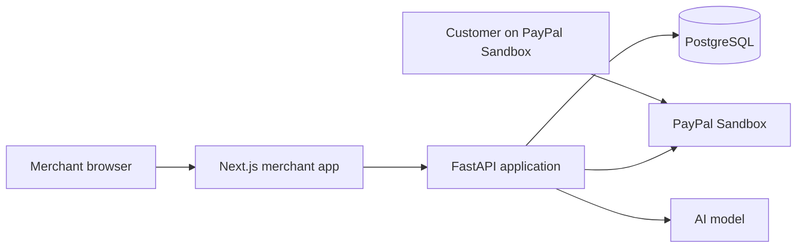
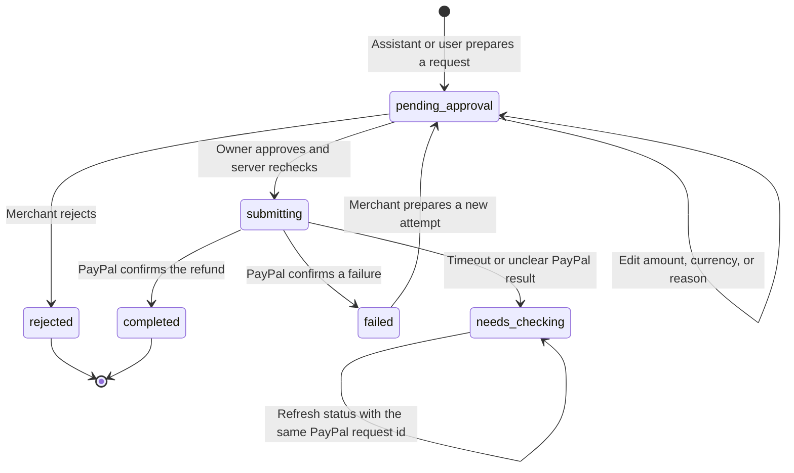
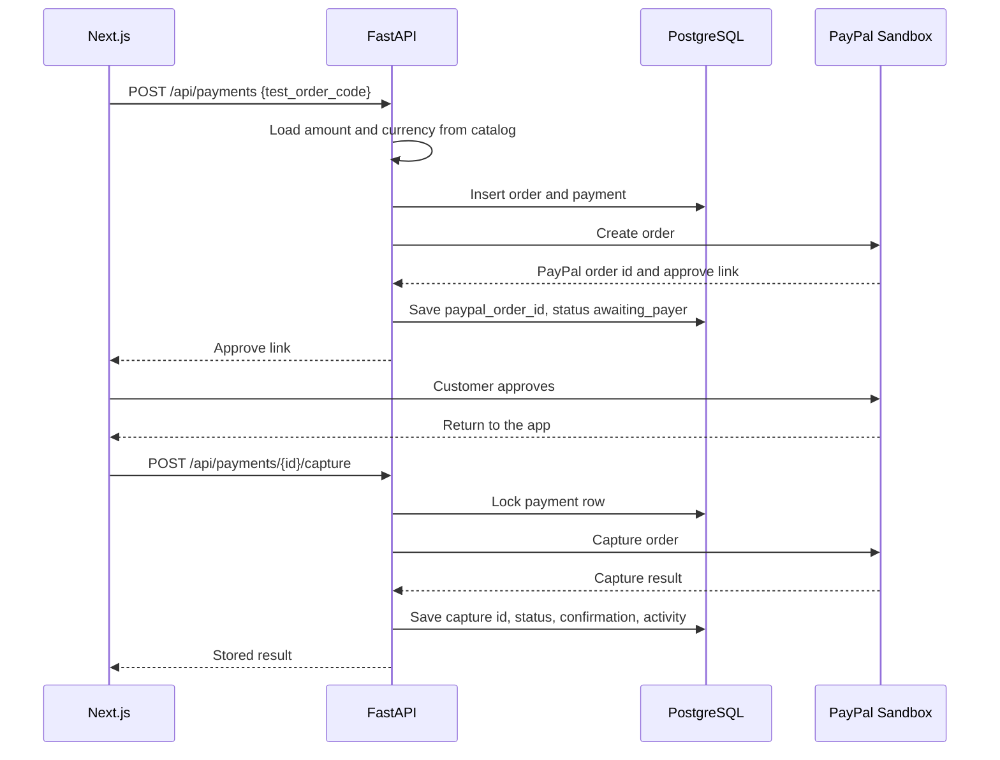
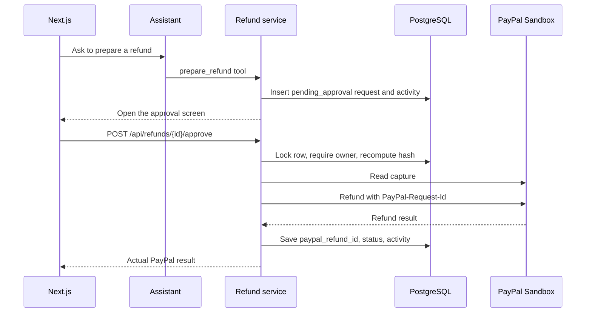

# PayFlow Guardian Architecture

This document describes how PayFlow Guardian is built. It follows [ProblemStatements.md](./ProblemStatements.md).

PayFlow Guardian is an AI-powered payment operations assistant for small online merchants. It uses PayPal Sandbox data to check payments, investigate problems, explain a next step, and prepare refunds. The merchant approves every refund before PayPal receives it. The first version is one Next.js application, one FastAPI application, and one PostgreSQL database.

## 1. Architecture goals

The system has to make a payment understandable and keep the financial decision with the merchant.

| Goal | What the architecture must guarantee |
| --- | --- |
| One workspace | Search, detail, investigation, recommendation, refund review, and activity history are reached from the same merchant application. |
| PayPal is the source of status | A payment status shown as confirmed comes from a PayPal Sandbox response stored by the server. |
| Human approval | The assistant can prepare a refund. Only an authenticated merchant approval causes the server to send that refund to PayPal. |
| Server-side money rules | Amount, currency, payer identity, and permission are checked on the server before PayPal is called. |
| Honest uncertainty | A timeout, a partial response, or a mismatch is stored and shown as needing a check. |
| Safe repetition | Repeating a capture or a refund request returns the original result and does not create a second refund. |
| Limited assistant | The model may call only an allowlist of server tools. It has no database credentials, no PayPal secret, and no approve or send tool. |
| Recorded actions | Payment creation, capture, investigation, refund preparation, approval, rejection, and PayPal results are written to an activity log. |
| Hackathon scope | Sandbox only. No live money, no card data, no card security codes. |

Optional work (webhooks, an attention queue, a timeline, and a saved-versus-PayPal comparison) is designed as an extension of the same modules. It is built only after the main payment and refund journey works.

## 2. System context



Trust boundaries:

- The browser and the model are untrusted. They may suggest an amount, a payment id, or a refund. The server loads the stored payment and the latest PayPal data and decides what is allowed.
- PayPal secret keys, access tokens, the database URL, and the AI API key exist only in the FastAPI process environment.
- The Next.js app may hold the public PayPal client id if a PayPal button needs it. It never holds the client secret.
- The customer approves payment on PayPal's hosted pages. PayFlow Guardian never collects a card number or security code.
- PayPal calls the public webhook URL only in the optional phase. Until that exists, payment truth is read by the server when the merchant creates, captures, opens, or investigates a payment.

## 3. Containers and responsibilities

### 3.1 Next.js and TypeScript

The frontend is the merchant workspace. It renders four areas:

| Area | Responsibility |
| --- | --- |
| Dashboard | Recent payments, status, amount, currency, PayPal reference, and actions that need attention. |
| Payment pages | Choose a test order, start PayPal approval, return from PayPal, search, and open a payment. |
| Assistant | Chat for payment questions. Shows the explanation, the recommended next step, and which PayPal facts the answer used. |
| Refund approval | Shows payment reference, amount, currency, and reason. Approve and reject are explicit buttons on this screen. |

The UI displays the server's confirmation state next to any assistant text. A sentence from the model does not change the badge from "Needs checking" to "Completed".

The browser talks only to the Next.js origin. Next.js rewrites `/api/*` to FastAPI and forwards the session cookie. That keeps PayPal and the model off the client and avoids exposing the API for the demo.

### 3.2 FastAPI

One Python process owns every sensitive action. Inside that process the code is split by responsibility so each part can be tested on its own.

| Module | Responsibility |
| --- | --- |
| `api` | HTTP routes, request schemas, and response schemas. Routes stay thin. |
| `auth` | Login, session, current user, and permission checks. |
| `catalog` | Server-defined test orders. Amount and currency are read here, never from the browser or the model. |
| `payments` | Create a PayPal order, capture an approved payment, search, detail, and status mapping. |
| `refunds` | Prepare, edit, approve, reject, and submit a refund. Owns the refund state machine. |
| `assistant` | Interprets the merchant message, calls allowlisted tools, and writes a grounded explanation. |
| `paypal` | OAuth, Orders, Captures, and Refunds calls. The only module that speaks to PayPal. |
| `activity` | Append-only record of important actions. |
| `core` | Settings, database session, logging, and error types. |

`assistant` may call `payments` and `refunds`. It does not call `paypal` directly. That keeps PayPal rules in one place.

### 3.3 PostgreSQL

PostgreSQL stores orders, payments, refund requests, approvals, and activity history. It is the system of record for what PayFlow Guardian has confirmed and what the merchant has decided. PayPal remains the system of record for the payment itself. When the two disagree, the payment is marked needs checking until a fresh PayPal read resolves it.

### 3.4 PayPal Sandbox

Used capabilities for the first version:

- OAuth 2.0 client-credentials token, cached in memory on the server until shortly before expiry.
- Orders v2: create order and capture order.
- Payments v2: refund a capture.

The value sent to PayPal for amount and currency is the value stored when the order was created from the catalog. A later client or model payload cannot replace it.

### 3.5 AI model

The model is called only from `assistant`. It receives the merchant message plus a fact sheet built by the server. It returns either a tool call from the allowlist or a final explanation. Tool arguments are validated by the server schema before a tool runs. The model vendor can be any chat API that supports tool calling. The vendor name and key stay in server configuration.

## 4. Repository layout

```text
payflow-guardian/
  apps/
    web/                          Next.js TypeScript app
      app/
        (auth)/login/
        (workspace)/
          page.tsx                Dashboard and activity
          payments/
          payments/[id]/
          assistant/
          refunds/[id]/
      lib/api.ts                  Typed calls to /api
    api/
      app/
        main.py
        core/
        api/
        modules/
          auth/
          catalog/
          payments/
          refunds/
          assistant/
          paypal/
          activity/
      tests/
  docs/
    ProblemStatements.md
    architecture.md
  docker-compose.yml              web, api, postgres
  .env.example                    names only, no secret values
```

`docker-compose` is the demo runtime: one web container, one API container, one Postgres container. The API reads secrets from the environment. `.env.example` lists the variable names and leaves the values empty.

## 5. Identity and permissions

The demo has one merchant business and three roles. Every payment, refund, and activity row belongs to that business. Queries always include `merchant_id` from the session, not from the request body.

| Action | Owner | Support / operations |
| --- | --- | --- |
| View dashboard, search, open a payment | Yes | Yes |
| Create a test payment and capture it | Yes | Yes |
| Ask the assistant to investigate or prepare a refund | Yes | Yes |
| Approve or reject a refund | Yes | No |
| View activity | Yes | Yes |

A user who is not a member of the business receives the same not-found response as a missing payment, so other merchants' references are not revealed.

Sessions are server-side, random, and stored hashed. The cookie is `HttpOnly`, `SameSite=Lax`, and `Secure` outside local HTTP. Passwords for the demo are hashed. They are never written to logs.

## 6. Domain model

### 6.1 Catalog

Test orders live in server configuration, not in a table the client can edit.

```text
test_order_code  description           amount_minor   currency
DEMO-25          Demo consultation     2500           USD
DEMO-49          Demo product          4900           USD
```

Amounts are integer minor units in the database and in service code. The PayPal adapter formats them to PayPal's decimal string at the boundary.

### 6.2 Tables

**orders**

| Column | Purpose |
| --- | --- |
| id | Internal id |
| merchant_id | Owning business |
| test_order_code | Catalog code the merchant selected |
| amount_minor, currency | Copied from the catalog at creation |
| status | `created`, `awaiting_payer`, `completed`, `failed`, `needs_checking` |
| created_by | User who started it |

**payments**

| Column | Purpose |
| --- | --- |
| id | Internal id |
| merchant_id, order_id | Ownership and link to the local order |
| paypal_order_id | PayPal order id, unique |
| paypal_capture_id | Set after a confirmed capture, unique when present |
| status | Local projection: `created`, `awaiting_payer`, `pending`, `completed`, `failed`, `refunded`, `partially_refunded`, `needs_checking` |
| confirmation | `confirmed` or `unconfirmed` |
| amount_minor, currency | From the local order |
| paypal_status | Last status string returned by PayPal |
| last_checked_at | Time of the last successful PayPal read |
| created_at, updated_at | |

**refund_requests**

| Column | Purpose |
| --- | --- |
| id | Internal id. Also sent as PayPal `PayPal-Request-Id` |
| merchant_id, payment_id | Ownership and target capture |
| amount_minor, currency, reason | The request the merchant must approve |
| payload_hash | Hash of payment id, capture id, amount, currency, and reason |
| status | See the state machine below |
| approved_by, approved_at, approved_hash | Set only by the approve route. `approved_hash` must equal `payload_hash` |
| paypal_refund_id | Set only after PayPal confirms a refund id |
| paypal_status | Last refund status string from PayPal |
| created_by | User or assistant-on-behalf-of user |

**activity_events**

| Column | Purpose |
| --- | --- |
| id | Internal id |
| merchant_id | Owning business |
| actor_user_id | Null for PayPal or system |
| actor_type | `user`, `assistant`, `system`, `paypal` |
| action | Stable verb such as `payment.captured` or `refund.approved` |
| entity_type, entity_id | Order, payment, or refund |
| summary | Short merchant-facing sentence |
| outcome | `confirmed`, `failed`, `needs_checking`, `rejected` |
| created_at | Append-only |

Activity rows store ids, amounts, currency, and PayPal reference ids. They do not store access tokens, secret keys, card numbers, or security codes.

**sessions** store the hashed session id, user id, and expiry.

### 6.3 Payment confirmation rule

`confirmation = confirmed` is allowed only when the server has stored a PayPal response that includes the PayPal order or capture id and a recognized status. Every other outcome uses `confirmation = unconfirmed` and `status = needs_checking` or a confirmed failure status when PayPal explicitly reports failure.

The assistant receives this pair as data. Its prompt tells it to describe `needs_checking` as not yet confirmed.

### 6.4 Refund state machine



Rules enforced in one database transaction with a row lock:

- Approve is a user route. The assistant has no function that sets `approved`.
- On approve, the server recomputes `payload_hash`. If the stored request no longer matches the payment's capture, amount, or currency, approval is refused and the request stays `pending_approval`.
- If amount, currency, reason, or target payment changes after approval and before a confirmed submit, the server clears `approved_by`, `approved_at`, and `approved_hash` and returns the request to `pending_approval`.
- A request in `submitting`, `completed`, or `needs_checking` cannot be edited into a second PayPal call. `needs_checking` is refreshed with the same `PayPal-Request-Id`.
- A second approve click after `completed` returns the stored refund result.
- One open refund request is allowed per capture. A new request is allowed after `rejected` or `failed`.

## 7. Main journeys

### 7.1 Create and complete a payment



The capture route is idempotent. If `paypal_capture_id` is already stored and `confirmation` is `confirmed`, the route returns that row and does not call PayPal again.

If PayPal returns an unrecognized body or the call times out after PayPal may have captured, the row becomes `needs_checking`. The UI tells the merchant the payment needs a check. The assistant uses the same wording.

### 7.2 Investigate a payment

1. The merchant opens a payment or asks in the assistant.
2. `payments` loads the row scoped to the session merchant.
3. `paypal` reads the latest order or capture.
4. The server writes a fact sheet: PayPal ids, PayPal status, amount, currency, `confirmation`, missing fields, and `last_checked_at`.
5. The fact sheet is saved on the payment as the latest read, and an activity event `payment.investigated` is appended.
6. The assistant explains only that fact sheet and recommends one next step.

Missing fields stay missing. The model is not given a way to fill them.

Fact sheet shape:

```json
{
  "payment_id": "pay_123",
  "paypal_order_id": "PAYPAL-ORDER",
  "paypal_capture_id": "PAYPAL-CAPTURE",
  "paypal_status": "COMPLETED",
  "local_status": "completed",
  "confirmation": "confirmed",
  "amount": "25.00",
  "currency": "USD",
  "missing": [],
  "checked_at": "2026-11-12T06:30:00Z"
}
```

When the PayPal read fails, `confirmation` is `unconfirmed`, `paypal_status` is null, and `missing` lists the fields the server could not refresh. The previous confirmed values stay labeled with the timestamp of the last successful check.

### 7.3 Prepare, approve, and send a refund



`prepare_refund` checks that the payment belongs to the merchant, the capture is confirmed completed, the currency matches, and the amount is greater than zero and no greater than the captured amount. It does not call the PayPal refund endpoint.

The approve route runs the checks again. Approval of a stale or edited request does not send money. Rejection writes `refund.rejected` and never calls PayPal.

### 7.4 View activity

`GET /api/activity` returns the newest events for the session merchant: status, amount, currency, PayPal reference, actor, and whether an action is still waiting. The dashboard is this list plus payments in `needs_checking` and refunds in `pending_approval`.

## 8. Assistant design

The assistant is a tool-using loop with a fixed budget of tool calls. It is not a general agent.

### 8.1 Allowlist

| Tool | Server effect |
| --- | --- |
| `find_payment` | Search by internal id or PayPal reference inside the merchant. |
| `list_recent_payments` | Return the latest payments for the merchant. |
| `create_test_order` | Create an order from a catalog code. |
| `complete_approved_payment` | Capture a payment the payer has already approved. |
| `investigate_payment` | Refresh from PayPal and return a fact sheet. |
| `prepare_refund_request` | Insert `pending_approval` with reference, amount, currency, and reason. |
| `check_operation_status` | Read the stored payment or refund and its confirmation state. |

There is no tool for approve, reject, or send. Those remain HTTP routes that require the owner session.

Tool arguments that name a payment are resolved inside the merchant scope. An unknown id returns a not-found fact, which the assistant reports as not found.

### 8.2 Loop

1. Build a system prompt with the allowlist, the confirmation rule, and the refund rule.
2. Send the merchant message and the current fact sheet when one already exists.
3. If the model requests a tool, validate the arguments, run the server function, append the tool result, and continue.
4. Stop when the model returns a final answer, or after three tool calls.
5. Persist the user message, the tool names, and the final answer. Do not persist raw provider payloads that might contain secrets.
6. Return the answer, the recommended next step, the confirmation badge from the server, and a refund id when a request was prepared.

The final answer is grounded by giving the model the fact sheet and by showing the badge from the API field `confirmation`. The UI treats the badge as the status.

### 8.3 Recommended next step

The server picks the step from the fact sheet so the recommendation does not depend on model wording:

| Condition | Next step |
| --- | --- |
| `awaiting_payer` | Ask the customer to approve the PayPal payment. |
| `needs_checking` | Refresh the payment before taking action. |
| `completed` and no open refund | Offer to prepare a refund if the merchant wants one. |
| Refund `pending_approval` | Open the approval screen. |
| Refund `completed` | Show the PayPal refund reference. |
| `failed` | Show PayPal's failure and stop. |

The model may explain that step in plain language. It does not choose a different financial action.

## 9. HTTP API

All routes except login and the optional webhook require a session. Responses use the internal id and the PayPal reference. Errors use a stable code plus a merchant-facing message.

| Method and path | Who | Effect |
| --- | --- | --- |
| `POST /api/auth/login` | Public | Create a session. |
| `POST /api/auth/logout` | User | End the session. |
| `GET /api/auth/me` | User | Current user and role. |
| `GET /api/catalog/test-orders` | User | Catalog codes, descriptions, amounts, currencies. |
| `POST /api/payments` | User | Body is `{ "test_order_code": "DEMO-25" }`. Creates the PayPal order. |
| `POST /api/payments/{id}/capture` | User | Captures an approved order or returns the stored capture. |
| `GET /api/payments` | User | Search by reference or status. |
| `GET /api/payments/{id}` | User | Detail, confirmation, latest fact sheet. |
| `POST /api/assistant/messages` | User | Body is `{ "message": "...", "conversation_id": "..." }`. |
| `POST /api/refunds` | User | Prepare a refund. The assistant uses the same service. |
| `GET /api/refunds/{id}` | User | Review payload. |
| `POST /api/refunds/{id}/approve` | Owner | Recheck and send to PayPal. |
| `POST /api/refunds/{id}/reject` | Owner | Reject without calling PayPal. |
| `GET /api/activity` | User | Recent important actions. |

Error codes the UI must show in plain language:

| Code | When |
| --- | --- |
| `not_found` | The payment or refund is outside the merchant or does not exist. |
| `validation_failed` | Amount, currency, or catalog code is unacceptable. |
| `approval_required` | A send was attempted without a current owner approval. |
| `approval_stale` | The request changed and must be approved again. |
| `paypal_failed` | PayPal explicitly failed the call. |
| `needs_checking` | The PayPal result is missing or unclear. |
| `forbidden` | The role cannot approve. |

## 10. Idempotency and concurrency

| Operation | Key | Behavior |
| --- | --- | --- |
| Create payment | Client `Idempotency-Key` header plus merchant id | The same key and same catalog code return the original payment. A reused key with a different code is rejected. |
| Capture | `paypal_order_id` | One confirmed capture is stored. Repeats return it. |
| Prepare refund | Open request for the capture | A second prepare returns the open request. |
| Submit refund | `refund_requests.id` as `PayPal-Request-Id` | PayPal treats a repeat as the same refund. A local unique index on `paypal_refund_id` blocks a duplicate row. |
| Approve click | Row lock on the refund | Two owners cannot both move `pending_approval` to `submitting`. |

The capture and approve handlers take `SELECT … FOR UPDATE` before any PayPal call that can move money or record money as moved.

## 11. PayPal adapter

`modules/paypal` exposes four operations to the rest of the app:

- `create_order(amount_minor, currency, return_url, cancel_url) -> order id, approve url`
- `capture_order(paypal_order_id) -> capture id, status, raw status`
- `get_order_or_capture(...) -> fact fields`
- `refund_capture(capture_id, amount_minor, currency, request_id) -> refund id, status`

The adapter maps known PayPal statuses onto the local status set. An unknown status becomes `needs_checking` and `unconfirmed`. Network errors and HTTP 5xx after a capture or refund also become `needs_checking`, because the call may have succeeded.

Tokens are requested with the client secret, kept in process memory, and refreshed on expiry or on a 401. They are not written to Postgres or to logs. Log lines may include PayPal ids and HTTP status. They must not include the `Authorization` header, the client secret, or request bodies that contain them.

The adapter is the place that will later verify webhook signatures. No other module accepts a PayPal payload.

## 12. Configuration and secrets

| Variable | Where it is used |
| --- | --- |
| `DATABASE_URL` | API only |
| `SESSION_SECRET` | API only |
| `PAYPAL_CLIENT_ID` | API. Public client id may also be passed to the web app if a button needs it. |
| `PAYPAL_CLIENT_SECRET` | API only |
| `PAYPAL_API_BASE` | Sandbox base URL |
| `PAYPAL_WEBHOOK_ID` | API, optional phase |
| `AI_BASE_URL`, `AI_API_KEY`, `AI_MODEL` | API only |
| `WEB_ORIGIN` | Cookie and PayPal return URLs |

`.env.example` ships the names with empty values. Real values stay in the local environment or the host's secret store. The web image does not receive `PAYPAL_CLIENT_SECRET` or `AI_API_KEY`.

Application logs go to stdout. A logging filter drops headers and JSON keys named `authorization`, `client_secret`, `api_key`, `password`, and `access_token`.

## 13. Failure behavior

| Situation | Stored result | What the merchant sees |
| --- | --- | --- |
| Catalog code is unknown | Nothing is created | The test order is not available. |
| PayPal order create fails | Order marked `failed` when PayPal says so | The payment was not created, with PayPal's message. |
| Customer cancels on PayPal | `failed` or remains `awaiting_payer` if PayPal has no cancel event | The payment was not approved. |
| Capture times out | `needs_checking` | The payment needs a check before another capture. |
| Investigate cannot reach PayPal | Previous row kept, `confirmation` unchanged if a prior confirmation exists, activity notes the failed refresh | The latest PayPal check did not complete. |
| Approve without owner role | No write | Only an owner can approve a refund. |
| Refund request edited | Approval fields cleared | Approve this request again. |
| Refund call times out | `needs_checking`, same request id | The refund needs a check. It is not sent again automatically. |
| PayPal refund explicitly fails | `failed` | The refund was not completed, with PayPal's message. |

The assistant uses these stored results. It does not replace them with a guessed status.

## 14. Optional phase

These attach to modules that already exist. They are not required for the judge story.

| Feature | Where it lives | Behavior |
| --- | --- | --- |
| Webhooks | `paypal` plus `POST /api/webhooks/paypal` | Verify the PayPal signature. Store `paypal_event_id` uniquely. Ignore duplicates. Update the payment or refund only from the verified event, then append activity. |
| Needs-attention list | `payments` query | Payments with `needs_checking` and refunds with `pending_approval`. |
| Timeline | `activity` | Events for one payment and its refunds, in time order. |
| Saved-versus-PayPal check | `investigate_payment` | Compare stored capture id, amount, currency, and status with the fresh PayPal read. A mismatch sets `needs_checking` and writes `payment.mismatch`. |

Webhook processing uses the same status mapper as the pull path. An unverified payload does not change a payment.

## 15. Security controls

These controls are the implementation of the safety section in the problem statement.

- PayPal responses are stored and shown as the confirmed status.
- Secrets and access tokens stay in the API environment and in memory.
- Every read and write checks the session user, role, and `merchant_id`.
- Amount and currency come from the catalog and are checked again before capture and refund.
- Refund send runs only on the owner approve route, after the payload hash matches.
- An edited refund clears approval.
- Capture and refund use idempotency keys and row locks.
- Unclear PayPal results use `needs_checking`.
- Important actions append an activity event in the same transaction as the local state change. The PayPal call sits inside that business operation; if the local save fails after a possible PayPal success, the row is `needs_checking` rather than silently dropped.
- The schema has no card number or security code column.
- The assistant tool registry is the complete set of side effects the model can request.

## 16. How the demo maps onto this architecture

| Judge step | Runtime path |
| --- | --- |
| Merchant creates a test order | Dashboard to `POST /api/payments` with a catalog code |
| Customer approves in PayPal Sandbox | PayPal hosted approval, then return URL |
| App shows the confirmed result | Capture route saves `confirmation = confirmed` |
| Merchant asks the assistant to investigate | `investigate_payment` refreshes PayPal and returns a fact sheet |
| Assistant explains PayPal's information | Final answer constrained to that fact sheet, badge from the server |
| Merchant asks to prepare a refund | `prepare_refund_request` creates `pending_approval` |
| Merchant reviews and approves | Refund screen and owner `POST /api/refunds/{id}/approve` |
| App sends the approved request | Refund service calls PayPal with `PayPal-Request-Id` |
| App shows the result and the activity record | Refund status plus `GET /api/activity` |
| Unapproved refund is blocked | No assistant tool and no API route sends a refund in `pending_approval` |

Any fixture that does not come from PayPal Sandbox is labeled as a test example in the UI. The activity row for a real Sandbox call includes the PayPal reference. A simulated row would be labeled `test example` and is not part of the default demo path.

## 17. Test strategy

Tests follow the checks in the problem statement. Service tests use a fake PayPal adapter. One end-to-end path uses Sandbox when credentials are present.

| Check | Test |
| --- | --- |
| Create and complete a Sandbox payment | Service test with a fake adapter, plus one Sandbox test when credentials exist. |
| Details match the provider response | Mapper test: given a PayPal body, the stored status, amount, currency, and ids match. |
| Assistant does not invent status | Prompt-and-tool test: a fact sheet with `unconfirmed` cannot produce a confirmed badge. The badge is an API field. |
| Refund blocked before approval | Call the PayPal fake from `prepare_refund` and assert it was not asked to refund. Approve route is the only caller. |
| Edited request needs approval again | Change the amount, then approve, and assert `approval_stale` and no PayPal refund call. |
| No access to another merchant's payment | Two merchants, fetch by id, expect `not_found`. |
| Repeated capture and refund | Call capture and approve twice. Assert one PayPal capture and one PayPal refund. |
| Webhook duplicates | Optional test: the same `paypal_event_id` updates state once. |
| Secrets stay out of the client and logs | Inspect the web bundle config and a log filter unit test. |
| Honest errors | Timeout from the fake adapter yields `needs_checking`. |

## 18. Build order

The build order matches the problem statement. Each step should leave the previous journey working.

1. Compose, Postgres, settings, and `.env.example`.
2. PayPal adapter for token and create order.
3. Catalog and `POST /api/payments`.
4. Return URL and capture.
5. Payment list and detail from stored rows.
6. Search and investigate with a live PayPal read.
7. Assistant loop and the allowlisted tools.
8. Refund prepare screen, owner approve, owner reject.
9. Activity log and the tests in section 17.
10. Webhooks, attention list, timeline, and comparison, if the main journey already works.
11. README, demo script, and submission cleanup.

## 19. Out of scope

The architecture does not include live PayPal payments, refunds without an owner approval, card data storage, accounting or banking ledgers, fraud guarantees, or an assistant that can run arbitrary SQL, shell, or HTTP. Those boundaries are product limits from the problem statement, and the modules above do not grow hidden paths around them.
