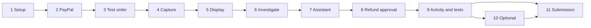

# PayFlow Guardian Implementation Plan

This plan is the build sequence for PayFlow Guardian. It follows the build order in [ProblemStatements.md](./ProblemStatements.md) and the module, data, and safety design in [architecture.md](./architecture.md). The merchant interface is a Next.js React application that follows [stitch_payflow_guardian_design_system](../stitch_payflow_guardian_design_system/payflow_guardian/DESIGN.md).

The required journey is phases 1 through 9 and phase 11. Phase 10 is optional and starts only after the main payment and refund journey works. Each phase leaves the previous journey working.

## How to use this plan

Work the phases in order. A phase is finished when its exit checks pass, including the checks inherited from earlier phases. Use a fake PayPal adapter in automated tests. Call PayPal Sandbox only when the phase exit check says so.

Chosen implementation of the architecture:

| Choice | Use |
| --- | --- |
| `apps/web` | Next.js App Router, React, TypeScript, and Tailwind. Visual source is `stitch_payflow_guardian_design_system` |
| `apps/api` | One FastAPI process, split into the modules in the architecture |
| PostgreSQL | Orders, payments, refund requests, sessions, and activity |
| SQLAlchemy and Alembic | Models and migrations |
| pytest and a fake PayPal adapter | Service tests |
| Docker Compose | `web`, `api`, and `postgres` for the demo |

The browser calls only the Next.js origin. Next.js rewrites `/api/*` to FastAPI and forwards the session cookie.

## Rules for every phase

- PayPal client secret, access tokens, `DATABASE_URL`, `SESSION_SECRET`, and `AI_API_KEY` stay in the API environment.
- Amount and currency sent to PayPal come from the server catalog or the stored order. The browser and the model cannot replace them.
- A confirmed status is stored only from a recognized PayPal response. Timeouts and unknown bodies become `needs_checking` and `unconfirmed`.
- Every payment and refund query includes `merchant_id` from the session.
- The assistant never receives a tool that approves or sends a refund.
- The database has no card number or security code column.
- Logs may include PayPal ids and HTTP status. They exclude `authorization`, `client_secret`, `api_key`, `password`, and `access_token`.
- New merchant-facing errors use the stable codes from the architecture: `not_found`, `validation_failed`, `approval_required`, `approval_stale`, `paypal_failed`, `needs_checking`, and `forbidden`.
- Simulated data shown in the UI is labeled as a test example. A Sandbox result includes the PayPal reference.
- Every merchant screen uses the shared shell, tokens, and components in the frontend section. A phase does not introduce a second color system, typeface, or control style.

## Frontend

The merchant application is one Next.js app in `apps/web`, written in React and TypeScript. Pages are React Server Components. Forms, search, the assistant composer, and approval buttons are Client Components. That keeps the session cookie and the `/api/*` rewrite on the Next.js origin.

Build the interface from the Stitch files, in this order of authority:

1. The screen HTML and `screen.png` files for layout, hierarchy, and copy structure.
2. The Brand, Colors, Typography, Layout, Elevation, Shapes, and Components sections of [DESIGN.md](../stitch_payflow_guardian_design_system/payflow_guardian/DESIGN.md).
3. The YAML token names in that file, mapped onto the operational hex values below when the YAML color differs from the screens.

The screens are the picture of the product. Names, amounts, order ids, and PayPal references inside those HTML files are design fixtures. Render stored API data in the same layout. Label a fixture that is not from the API as a test example, and do not ship the sample rows as the live dashboard.

### Operational tokens

Encode these as CSS variables and as the Tailwind theme. Inter is loaded with `next/font` at weights 400, 500, 600, and 700. Currency, counts, dates, and PayPal ids use `font-variant-numeric: tabular-nums lining-nums`.

| Role | Value | Use |
| --- | --- | --- |
| Canvas | `#F5F7FA` | Page background |
| Surface | `#FFFFFF` | Header, cards, tables, inputs |
| Hairline | `#E6E8EB` | 1px borders |
| Primary text | `#001C64` | Titles, values, primary labels |
| Secondary text | `#687173` | Metadata, timestamps, table headers |
| Primary action | `#0070E0`, hover `#003087` | The one filled action on a screen |
| Focus ring | `rgba(0, 112, 224, 0.40)` | 2px outer offset on keyboard focus |
| Disabled | Background `#CCD2D8`, text `#8C96A0` | Unavailable actions |
| Completed | Text `#0E7A3D`, surface `#E8F6EE` | Confirmed completed payments |
| Pending | Text `#8A5A00`, surface `#FFF6E0` | Awaiting payer, pending, needs checking |
| Failed | Text `#B42318`, surface `#FDECEC` | Explicit PayPal or validation failure |
| Refunded | Text `#3D4C66`, surface `#EEF2F6` | Refunded, partially refunded, Sandbox chip |

Cards and data modules use an 8px radius and a 1px hairline, with no shadow. Raised cards, used for the selected workspace modules in the screens, add `box-shadow: 0 1px 2px rgba(0, 28, 100, 0.06)`. Modals use `box-shadow: 0 4px 16px rgba(0, 28, 100, 0.12)` and a solid backdrop `rgba(0, 28, 100, 0.32)`. Buttons and inputs are 40px tall with a 6px radius. Status chips are 22px tall with a 4px radius. Status is never a pill.

The interface has no gradients, no blur, no decorative illustration, and no second accent color. The current paper-and-serif styles in `apps/web/app/globals.css` are replaced by these tokens in phase 1.

### Screen map

| Stitch screen | Route | Built in |
| --- | --- | --- |
| `payflow_guardian_merchant_sign_in` | `/login` | Phase 1 |
| `payflow_guardian_dashboard` | `/` | Shell in phase 1, live data in phases 5 and 9 |
| `payflow_guardian_payments` | `/payments` | Phase 3 list action, phase 5 table, phase 6 search |
| `payflow_guardian_payment_detail` | `/payments/[id]` | Phases 4, 5, and 6 |
| PayPal return, same detail language | `/payments/[id]/return` and `/payments/[id]/cancel` | Phase 4 |
| `payflow_guardian_assistant` | `/assistant` | Phase 7 |
| `payflow_guardian_review_refund` | `/refunds/[id]` | Phase 8 |
| `payflow_guardian_style_tile` | No route | Reference for the shared components |

`/refunds` stays in the header because every Stitch workspace screen has that item. Until a refund exists it opens an empty state in the same table language as Payments. After phase 8 it lists refund requests and links each row to `/refunds/[id]`.

### Shared React components

Put reusable pieces in `apps/web/components` and keep pages thin.

| Component | Responsibility |
| --- | --- |
| `AppHeader` | 64px white bar, wordmark, Sandbox chip, nav, signed-in name, role, merchant, sign out |
| `AppFooter` | Hairline footer with the Sandbox notice. Policy and cookie links in the HTML are not routes |
| `Button` | Primary, secondary, quiet, and destructive. One primary button per screen region |
| `TextField` | 40px field, hairline border, focus ring, 12px error caption |
| `StatusChip` | Maps server `status` and `confirmation` to the four chip treatments |
| `Card` | Flat or raised operational card |
| `DataTable` | Header, body, row hover, right-aligned amounts, empty row |
| `EmptyState` | Short title, one sentence, and the next real action |
| `ErrorBanner` | Stable API code rendered as the plain-language message from the architecture |
| `Modal` | New test order, and any confirm step that must stay on the page |

Icons used by the screens are `search`, `add`, `arrow_back`, and `info`, from Material Symbols Outlined at 16–20px. Load that font once in the root layout.

### How data fills the layout

| Screen region | Source |
| --- | --- |
| Header identity | `GET /api/auth/me` |
| Dashboard counts | Derived from the session merchant's payments and refunds. Zero is `$0.00` or `0`, not a sample number |
| Waiting table | Payments in `needs_checking` and refunds in `pending_approval` |
| Latest from PayPal | `GET /api/activity`, shown from phase 9. Earlier phases keep the card with an empty line |
| Payments table | `GET /api/payments`. Columns are created time, catalog code, amount, currency, status, and PayPal reference |
| Customer or payer | Shown only when PayPal returned it. The sample names in the HTML are not a customer directory |
| Payment detail amount | Stored amount and currency, set as the page title in `display-currency` |
| What PayPal returned | Stored row, then the fact sheet after phase 6 |
| Assistant transcript | Persisted messages. The context rail reads the fact sheet and `confirmation` |
| Refund sheet | `GET /api/refunds/{id}` |

`StatusChip` reads server fields. Assistant prose cannot change it. `needs_checking` and `confirmation = unconfirmed` use the pending colors and the label "Needs checking". A completed chip is rendered only when the stored status is `completed` and `confirmation` is `confirmed`.

Filter chips on Payments send the server status filter: Completed, Pending (`awaiting_payer` and `pending`), Needs checking, Failed, and Refunded (`refunded` and `partially_refunded`). The active chip uses the `#0070E0` outline from the payments screen.

The assistant action row links only to a server next step: open the payment, or open the refund review. It does not include a control that approves a refund, and it does not include the sample "note to the customer" action. The sign-in screen does not include a password reset flow. The payments footer does not say auto-sync is active unless phase 10 webhooks are actually on.

Copy stays short and operational, in the voice of the screens: PayPal is the source of a confirmed result, a refund is not sent until the owner approves, and Sandbox does not move live money.

### Interaction quality

- Desktop layout matches the screen at 1280px and above: 12 columns, 24px gutters, 32px page margins, content capped near 1440px.
- From 768px to 1023px, the dashboard and detail grids stack to one column and the header keeps the four links if they fit.
- Below 768px, the header collapses the nav into a button that opens the same four links. Tables become stacked hairline cards with the same fields. The sign-in panels stack, form under the introduction.
- Keyboard focus is visible on every link, button, and field. The pointer is not the only way through sign-in, search, create, capture return, chat, and approve.
- Tables and lists announce an empty, loading, or error condition in text. Loading keeps the page chrome and shows quiet placeholder rows inside the card. Buttons that call the API disable themselves and keep their label until the response returns.
- Field errors sit under the field. Page-level failures use `ErrorBanner` and the stable codes `not_found`, `validation_failed`, `approval_required`, `approval_stale`, `paypal_failed`, `needs_checking`, and `forbidden`.
- Amounts are formatted for display from server minor units. The client never sends an amount or currency back.
- Support sees the refund payload and the sentence that support cannot send it. Approve and reject render only for the owner. The API remains the authority if the role changes.

### Frontend exit bar

A phase that touches a screen is finished only when:

- The route uses `AppHeader` or the sign-in layout, the operational tokens, and the shared components.
- Real or honestly empty API data occupies the sample regions.
- Loading, empty, and error states use the same type, color, and radius as the ready state.
- The narrow layout still reaches the primary action.
- A confirmation or status chip still comes from the server field after the phase's data is wired.

## Phase map

| Phase | Problem-statement step | Result | Required |
| --- | --- | --- | --- |
| 1 | Set up the project and secure configuration | Compose, config, auth, empty workspace shell | Yes |
| 2 | Connect to PayPal Sandbox | Token and PayPal adapter behind one module | Yes |
| 3 | Create a test order | Catalog order becomes a PayPal order | Yes |
| 4 | Complete approval and capture | Approved Sandbox payment is stored as confirmed | Yes |
| 5 | Save and display payment information | List and detail from stored rows | Yes |
| 6 | Add search and investigation | Fresh PayPal read and a fact sheet | Yes |
| 7 | Add the AI assistant | Allowlisted tools and a grounded explanation | Yes |
| 8 | Add refund preparation and approval | Owner approval is the only send path | Yes |
| 9 | Save activity history and test important cases | Activity screen and the safety test list | Yes |
| 10 | Webhooks and payment checks if time allows | Webhooks, attention list, timeline, comparison | No |
| 11 | README, demo, and submission | Public repo, demo script, and submission checklist | Yes |



Phase 11 can start its README outline during earlier phases. The submission pass happens after phase 9, and after phase 10 only if that optional work is included.

## Phase 1. Project setup and secure configuration

**Outcome.** A merchant can sign in to an empty workspace. The API, web app, and Postgres start from Compose. Secrets are named in `.env.example` and read only by the API.

**Backend**

- Create `apps/api` with `main.py`, `core` settings, database session, and the module packages from the architecture: `auth`, `catalog`, `payments`, `refunds`, `assistant`, `paypal`, `activity`, and `api`.
- Load `DATABASE_URL`, `SESSION_SECRET`, `PAYPAL_CLIENT_ID`, `PAYPAL_CLIENT_SECRET`, `PAYPAL_API_BASE`, `PAYPAL_WEBHOOK_ID`, `AI_BASE_URL`, `AI_API_KEY`, `AI_MODEL`, and `WEB_ORIGIN`. Missing required settings fail startup with a clear message. `PAYPAL_WEBHOOK_ID` and the AI settings may be empty until their phases.
- Add the log filter for secret-bearing header and JSON names.
- Add Alembic. First migration: `merchants`, `users`, `sessions`.
- Add the `activity_events` table and `activity.record()` in this phase so later phases write events in the same transaction as the state change. The merchant history screen waits until phase 9.
- Seed one merchant, one owner, and one support user. Store password hashes. Store session ids hashed. Cookie is `HttpOnly` and `SameSite=Lax`, and `Secure` outside local HTTP.
- Routes: `POST /api/auth/login`, `POST /api/auth/logout`, `GET /api/auth/me`.
- Health route for Compose.

**Frontend**

- Add Tailwind to `apps/web` and replace the paper-and-serif rules in `globals.css` with the operational tokens. Load Inter through `next/font` and Material Symbols once in the root layout.
- Build `Button`, `TextField`, `StatusChip`, `Card`, `EmptyState`, `ErrorBanner`, `AppHeader`, and `AppFooter` from `payflow_guardian_style_tile` and the Components section of `DESIGN.md`.
- Build `/login` from `payflow_guardian_merchant_sign_in`: 58/42 split, Sandbox chip, the three operational lines, and the sign-in card. Seeded owner and support emails are listed as test accounts. There is no reset-password link.
- Build the workspace shell from the shared header on the dashboard, payments, assistant, and refund screens: 64px white bar, Sandbox chip, Dashboard, Payments, Assistant, Refunds, the signed-in name and role from `GET /api/auth/me`, and sign out. Empty pages use `EmptyState` inside a hairline card. Below 768px the four links move into a header menu.
- Rewrite `/api/*` to FastAPI and forward the session cookie.
- `lib/api.ts` sends typed requests and surfaces the stable error codes through `ErrorBanner` and field captions.
- The web environment does not receive `PAYPAL_CLIENT_SECRET`, `AI_API_KEY`, `DATABASE_URL`, or `SESSION_SECRET`.

**Compose**

- Services: `postgres`, `api`, `web`.
- API runs migrations on startup for the demo.
- `.env.example` lists every variable with empty values.

**Exit checks**

- `docker compose up` serves the login page and the API health route.
- Owner and support can log in and log out. `GET /api/auth/me` returns the role.
- Sign-in matches the Stitch split layout, and the workspace header matches the Stitch bar on a desktop width and still reaches all four areas below 768px.
- A unit test shows the log filter removes a fake bearer token and client secret.
- The web bundle and `.env.example` contain no real secret values.

## Phase 2. Connect to PayPal Sandbox

**Outcome.** The API can obtain a Sandbox access token and call PayPal only through `modules/paypal`. No payment is created from the UI yet. The phase 1 shell stays on the Stitch tokens. This phase adds no PayPal connect screen.

**Backend**

- Implement the adapter operations, with create and capture filled in far enough to authenticate and parse errors. Refund and read can return a clear "not implemented" until phases 6 and 8, or be stubbed against the fake adapter.
  - `create_order(amount_minor, currency, return_url, cancel_url)`
  - `capture_order(paypal_order_id)`
  - `get_order_or_capture(...)`
  - `refund_capture(capture_id, amount_minor, currency, request_id)`
- Request the OAuth client-credentials token with the client secret. Cache it in process memory. Refresh it shortly before expiry and after a 401.
- Map known PayPal statuses to `created`, `awaiting_payer`, `pending`, `completed`, `failed`, `refunded`, and `partially_refunded`. Unknown status, timeout, and HTTP 5xx become `needs_checking` and `unconfirmed`.
- Add a fake adapter with the same interface for tests. Tests never hit Sandbox.
- Keep PayPal ids and HTTP status in logs. Drop the `Authorization` header and token body.

**Manual Sandbox check**

- One local command or test, skipped when credentials are absent, fetches a token from `PAYPAL_API_BASE` and prints only the HTTP status.

**Exit checks**

- Fake adapter tests cover a successful token, a 401 refresh, a known status, and an unknown status.
- No other module imports an HTTP client aimed at PayPal.
- `PAYPAL_CLIENT_SECRET` is read in the API settings and nowhere in `apps/web`.

## Phase 3. Create a test order

**Outcome.** The merchant selects a server-defined test order. The API copies amount and currency from the catalog, creates a PayPal Sandbox order, and returns the approval link.

**Data**

- Migration for `orders` and `payments` as specified in the architecture.
- Unique `paypal_order_id` when present.
- Catalog in server configuration:

| Code | Description | Amount | Currency |
| --- | --- | --- | --- |
| `DEMO-25` | Demo consultation | 2500 minor units | USD |
| `DEMO-49` | Demo product | 4900 minor units | USD |

**Backend**

- `GET /api/catalog/test-orders` returns code, description, display amount, and currency.
- `POST /api/payments` accepts `{ "test_order_code": "DEMO-25" }` plus an `Idempotency-Key` header.
- Look up the catalog inside the session merchant. Reject an unknown code with `validation_failed` and write nothing.
- Insert the order and payment, call `create_order` with the catalog amount and currency, then store `paypal_order_id` and `awaiting_payer`.
- The same idempotency key and catalog code return the original payment. The same key with a different code is rejected.
- On an explicit PayPal failure, store `failed` when PayPal says the order was not created, and return `paypal_failed`.
- Record `payment.created` through `activity.record()`.
- Ignore any amount or currency in the request body.

**Frontend**

- Payments uses the `payflow_guardian_payments` page header and toolbar. "New test order" opens a `Modal` listing `DEMO-25` and `DEMO-49` with the server display amount and currency. The form submits only `test_order_code` and an `Idempotency-Key`.
- The catalog rows are labeled test orders. Amount inputs are not on the form.
- After success, the page shows the stored PayPal reference and the approval link in a hairline card, with the pending chip for `awaiting_payer`. A `paypal_failed` response uses `ErrorBanner` and the failed chip when a row was stored.

**Exit checks**

- Service test: `DEMO-25` persists 2500 USD even if the client also sends another amount.
- Service test: repeated idempotency key creates one PayPal order.
- Service test: unknown code creates no row.
- Sandbox check, when credentials exist: the approval link opens a Sandbox order for the catalog amount.

## Phase 4. Customer approval and payment capture

**Outcome.** The customer approves on PayPal Sandbox. The merchant returns to the app. The server captures the order and shows the confirmed result.

**Backend**

- PayPal return and cancel URLs point at the web app and include the internal payment id.
- `POST /api/payments/{id}/capture` loads the payment with `SELECT … FOR UPDATE` inside the merchant scope.
- If a confirmed `paypal_capture_id` is already stored, return that row and do not call PayPal.
- Otherwise call `capture_order`. On a recognized success, store the capture id, PayPal status, `completed`, and `confirmation = confirmed`.
- On timeout or an unclear body, store `needs_checking` and `unconfirmed`. Do not start a second capture automatically.
- On an explicit PayPal failure, store `failed` and return `paypal_failed`.
- A cancel return leaves the payment `awaiting_payer` when PayPal has no cancel event, or `failed` when PayPal reports the order void. The UI says the payment was not approved.
- Record `payment.captured` or `payment.needs_checking`.

**Frontend**

- `/payments/[id]/return` and `/payments/[id]/cancel` use the payment detail header from `payflow_guardian_payment_detail`: back link, amount as the title, `StatusChip`, and the PayPal reference in the meta line.
- The return page calls capture once. It renders the stored status, amount, currency, PayPal order id, and capture id. The completed chip appears only when `confirmation` is `confirmed`. `needs_checking` uses the pending colors and the label "Needs checking", plus the note bar from the detail screen.
- The cancel page uses the same layout and says the payment was not approved. The chip follows the stored status.

**Exit checks**

- Fake adapter: a successful capture stores the capture id and `confirmed`.
- Fake adapter: a second capture call does not call PayPal again.
- Fake adapter: a timeout yields `needs_checking` and one PayPal attempt.
- Sandbox check, when credentials exist: create, approve with a Sandbox buyer, capture, and see `confirmed` in the app.
- Another merchant's payment id returns `not_found`.

## Phase 5. Save and display payment information

**Outcome.** The merchant can see recent payments and open a stored payment. The screen matches what the server stored from PayPal.

**Backend**

- `GET /api/payments` lists the session merchant's payments: status, confirmation, amount, currency, PayPal reference, and updated time.
- `GET /api/payments/{id}` returns the stored detail and the latest fact sheet if one exists. Until phase 6, the fact sheet can be the stored projection.
- Queries filter on `merchant_id` from the session. A missing or foreign id returns `not_found`.

**Frontend**

- Dashboard follows `payflow_guardian_dashboard`. The four strips are Open payments, Awaiting customer, Refunds to review, and Confirmed today, computed from stored rows. Refunds to review stays `0` until phase 8. Counts and money use tabular figures. An empty merchant sees `0` and `$0.00`, not the sample totals in the HTML.
- "Waiting on you" lists payments that need a check. With none, the card explains that no test payment is waiting. Each row links to the payment and shows amount, `StatusChip`, PayPal reference, and updated time.
- "Latest from PayPal" keeps the aside from the screen and shows one empty line until phase 9.
- Payment detail follows `payflow_guardian_payment_detail`. The title is the stored amount and currency. "What PayPal returned" is a definition list of status, PayPal ids, amount, currency, and updated time. "Prepare refund" stays disabled, with the caption that it is available after PayPal marks the payment completed. "Ask the assistant" links to `/assistant` with the payment id.
- `needs_checking` uses the pending note bar and shows the last successful check time when present.
- An empty payments table uses `EmptyState` and the "New test order" action. Below 768px each payment is a stacked card with the same fields.

**Exit checks**

- A completed Sandbox or fake payment appears on the dashboard and detail page with the same amount, currency, and PayPal ids as the stored row.
- Support and owner can both view. A second merchant cannot.
- Mapper test: a sample PayPal capture body produces the stored status, amount, currency, and ids.

## Phase 6. Search and investigation

**Outcome.** Search finds a payment. Opening or refreshing it reads the latest PayPal data and shows what is confirmed and what is missing.

**Backend**

- Extend `GET /api/payments` with search by internal id, PayPal order id, PayPal capture id, and status.
- Implement `get_order_or_capture` in the PayPal adapter.
- Add an investigate service used by the detail refresh. It writes a fact sheet:

```json
{
  "payment_id": "pay_123",
  "paypal_order_id": "PAYPAL-ORDER",
  "paypal_capture_id": "PAYPAL-CAPTURE",
  "paypal_status": "COMPLETED",
  "local_status": "completed",
  "confirmation": "confirmed",
  "amount": "25.00",
  "currency": "USD",
  "missing": [],
  "checked_at": "2026-11-12T06:30:00Z"
}
```

- Update `last_checked_at`, `paypal_status`, and confirmation from that read.
- If PayPal cannot be reached, keep the previous confirmation, list the missing fields, and record that the refresh did not complete.
- Record `payment.investigated`.
- The assistant is not part of this phase. The payment page can call investigate directly.

**Frontend**

- The payments toolbar search matches the Stitch field: 40px, search icon, placeholder for a PayPal reference. Filter chips bind to the server status filter and keep the active `#0070E0` outline.
- The detail page adds a secondary "Refresh from PayPal" button. "What PayPal returned" renders the fact sheet, including missing fields. A failed refresh keeps the previous chip and says the check did not complete.
- The note bar stays visible while `confirmation` is `unconfirmed`. The chip still comes from the server `confirmation` field.

**Exit checks**

- Search by PayPal capture id returns only the current merchant's payment.
- A successful read updates `last_checked_at` and the fact sheet.
- A failed read does not change a prior `confirmed` status and does not invent a new one.
- An unrecognized PayPal status becomes `needs_checking`.

## Phase 7. AI assistant

**Outcome.** The merchant can ask a payment question. The assistant calls only the allowlisted tools, explains the server fact sheet, and recommends the server-chosen next step.

**Backend**

- `POST /api/assistant/messages` with `{ "message": "...", "conversation_id": "..." }`.
- Tool registry, and no other tools:

| Tool | Service |
| --- | --- |
| `find_payment` | Merchant-scoped search |
| `list_recent_payments` | Latest payments |
| `create_test_order` | Phase 3 create path |
| `complete_approved_payment` | Phase 4 capture path |
| `investigate_payment` | Phase 6 investigate path |
| `prepare_refund_request` | Stub that returns "available in the next phase" until phase 8, then the real prepare service |
| `check_operation_status` | Stored payment confirmation |

- Validate tool arguments before running them. Resolve payment ids inside the session merchant.
- Loop at most three tool calls, then require a final answer.
- Persist the user message, tool names, and final answer. Do not persist raw provider payloads.
- The next step is chosen by the server from the fact sheet, using the table in the architecture. The model may explain that step and cannot select a different financial action.
- The response includes the answer, the next step, the server confirmation badge, and the fact sheet the answer used.
- `AI_API_KEY` is required for this phase and is present only in the API environment.
- `assistant` calls `payments` and, from phase 8, `refunds`. It does not call `paypal` directly.

**Frontend**

- `/assistant` follows `payflow_guardian_assistant`: a 720px thread card and a 360px "In context" rail. On a narrow viewport the rail stacks under the thread.
- The thread shows the merchant message, the assistant answer, the time, and whether the answer used a PayPal read. The composer is a 40px field and a primary Send button. Sending disables the button until the response returns.
- The rail shows the fact sheet: amount, currency, PayPal reference, updated time, and `StatusChip`. The chip reads `confirmation`. Assistant prose cannot flip it to completed. The rail includes the sentence that the assistant cannot approve or send a refund.
- Suggested actions are links for the server next step only: open the payment, or open refund review when the next step is approval. The chat transcript has no approve control.
- If the model is unavailable, the thread says the explanation could not be completed and the rail still shows the latest stored payment facts.

**Exit checks**

- A test doubles the model and asserts an unknown tool is rejected.
- A fact sheet with `confirmation = unconfirmed` keeps that badge in the API response.
- `create_test_order` through the assistant still uses the catalog amount.
- The tool list in code matches the table above and contains no approve or send tool.
- Support and owner can both call the assistant. A payment outside the merchant is reported as not found.

## Phase 8. Refund preparation and merchant approval

**Outcome.** The assistant or the merchant can prepare a refund. PayPal receives a refund only after the owner approves the current payload. Support cannot approve.

**Data**

- Migration for `refund_requests` with amount, currency, reason, `payload_hash`, status, approval fields, `paypal_refund_id`, and `paypal_status`.
- Unique `paypal_refund_id` when present.
- One open request per capture.

**Backend**

- Implement `refund_capture` in the PayPal adapter. Send `PayPal-Request-Id` set to `refund_requests.id`.
- `prepare_refund` checks merchant ownership, a confirmed completed capture, matching currency, and an amount greater than zero and no greater than the captured amount. It inserts `pending_approval`. It does not call `refund_capture`.
- A second prepare for the same open capture returns that request.
- `payload_hash` covers payment id, capture id, amount, currency, and reason.
- Editing amount, currency, reason, or target payment clears `approved_by`, `approved_at`, and `approved_hash` and returns the request to `pending_approval` when it has not been submitted.
- Routes:
  - `POST /api/refunds`
  - `GET /api/refunds/{id}`
  - `POST /api/refunds/{id}/approve` for the owner
  - `POST /api/refunds/{id}/reject` for the owner
- Approve locks the row, requires the owner role, recomputes the hash, reads the capture from PayPal, and only then calls `refund_capture`.
- Hash mismatch returns `approval_stale` and does not call PayPal.
- Support approve returns `forbidden`.
- A request still in `pending_approval` cannot reach the refund call. There is no separate send route.
- Explicit PayPal failure stores `failed`. Timeout or an unclear body stores `needs_checking` and keeps the same request id for a later status read. It does not create another refund.
- A repeated approve after `completed` returns the stored refund.
- Two concurrent approves: one wins the lock and the other receives the stored result.
- Reject stores `rejected` and does not call PayPal.
- Wire `prepare_refund_request` to this service.
- Record `refund.prepared`, `refund.approved`, `refund.rejected`, `refund.completed`, `refund.failed`, and `refund.needs_checking`.

**Frontend**

- `/refunds/[id]` follows `payflow_guardian_review_refund`: a 760px sheet titled "Refund draft", a "Not sent" chip while status is `pending_approval`, and a two-column definition list for payment reference, original amount, refund amount, currency, reason, and who prepared it.
- The confirmation note uses the screen copy: approving sends the refund to PayPal Sandbox. Reject is the quiet button. "Approve and send" is the primary button. Support sees the payload and the sentence that support cannot send it, and does not see either button. The API still enforces the role.
- After approve, the sheet shows the PayPal refund id and status from the response, and the chip moves to completed, failed, or needs checking from that response.
- `approval_stale` uses `ErrorBanner` and tells the merchant to approve the current request again. The buttons call the current payload only.
- `/refunds` lists prepared requests in the payments table language and links each row here.
- The assistant links to this screen when the next step is approval. It does not show an approve control inside the chat transcript.

**Exit checks**

- Prepare with the fake PayPal adapter records zero refund calls.
- Owner approve performs one refund call. A second approve performs none.
- Changing the amount and then approving returns `approval_stale` and performs zero refund calls.
- Support approve returns `forbidden` and performs zero refund calls.
- Timeout stores `needs_checking` and does not schedule another refund.
- A foreign refund id returns `not_found`.

## Phase 9. Activity history and the important tests

**Outcome.** The merchant can see what happened. The safety checks from the problem statement pass. This is the gate for the judge demo.

**Backend and frontend**

- `GET /api/activity` returns the newest events for the session merchant: action, summary, status context, amount, currency, PayPal reference, actor, outcome, and time.
- Dashboard "Latest from PayPal" renders those events in the Stitch aside: time, one-line summary, and PayPal reference. "Waiting on you" lists `needs_checking` payments and `pending_approval` refunds, with the row action linking to the payment or the refund review.
- Payment detail "Activity" uses the timeline from the detail screen: hairline rail, time, and one sentence per event. The latest event uses the `#0070E0` marker.
- Confirm every earlier write path records an event in the same transaction as the local change: create, capture, investigate, prepare, approve, reject, and PayPal result.
- Activity rows contain ids, amounts, currency, and PayPal references. They contain no tokens, secrets, card numbers, or security codes.

**Test pass**

Run the architecture test list, except webhook duplicates, which belong to phase 10.

| Check | What must pass |
| --- | --- |
| Create and complete a payment | Fake adapter covers the path. One Sandbox test runs when credentials exist. |
| Details match PayPal | Mapper test for status, amount, currency, and ids. |
| Assistant does not invent status | Unconfirmed fact sheet keeps an unconfirmed API badge. |
| Refund blocked before approval | Prepare does not call the refund operation. |
| Edited refund needs approval again | `approval_stale` and no refund call. |
| Merchant isolation | A second merchant receives `not_found`. |
| Repeated capture and refund | One capture call and one refund call. |
| Secrets | Web config has no API secret. Log filter test still passes. |
| Honest errors | Timeout becomes `needs_checking`. |

**Exit checks**

- The demo story in the architecture can be walked with Sandbox: create, approve, confirmed result, investigate, prepare, owner approve, PayPal result, activity row, and a blocked unapproved refund.
- Support can investigate and prepare, and cannot approve.
- Phase 10 is still absent. The demo does not depend on webhooks.

## Phase 10. Optional payment checks

Start this phase only after phase 9's demo path works. Stop when time runs out and go to phase 11. Skip a sub-phase rather than leaving it half-connected to PayPal.

### 10a. Webhooks

- `POST /api/webhooks/paypal` is public and unauthenticated apart from PayPal signature verification inside `modules/paypal`.
- Require `PAYPAL_WEBHOOK_ID`.
- Store `paypal_event_id` uniquely. A duplicate event updates nothing.
- An unverified payload does not change a payment or refund.
- A verified event uses the same status mapper as the pull path and appends activity.
- Test the same `paypal_event_id` twice and assert one state change.

### 10b. Needs-attention list

- Dashboard query for payments in `needs_checking` and refunds in `pending_approval`.
- Each row links to the payment or the refund approval screen.

### 10c. Timeline

- `GET /api/payments/{id}/timeline` returns activity for that payment and its refunds in time order.
- The detail page renders that timeline in the Activity column already built in phase 9.
- A foreign payment id returns `not_found`.

### 10d. Saved-versus-PayPal comparison

- Extend investigate. Compare stored capture id, amount, currency, and status with the fresh PayPal read.
- On a mismatch, set `needs_checking` and record `payment.mismatch`.
- The detail note bar says the saved payment and the latest PayPal data differ and need a check. The chip stays on "Needs checking".

**Exit checks**

- Optional tests cover duplicate webhooks and a forced mismatch.
- The phase 9 Sandbox demo still passes with these features turned on.

## Phase 11. README, demo, and submission

**Outcome.** A judge can run the project, watch one complete story, and check every public claim against the code.

**README**

- What the product does, who it is for, and the safety rules a judge should notice.
- The merchant screens follow `stitch_payflow_guardian_design_system`. The sample rows in those HTML files are design fixtures, and the demo uses Sandbox data.
- Sandbox-only scope, and the list of what is not included from the problem statement.
- Setup: Compose, `.env.example`, migrations, and the seeded owner and support users.
- How to create a Sandbox order, approve it, investigate it, and approve a refund.
- How to see that an unapproved refund is blocked.
- Which phase 10 features are present. Omit any feature that was not finished.

**Demo script**

Follow the judge story in order:

1. Owner creates `DEMO-25`.
2. Sandbox buyer approves.
3. The app shows `confirmed` and the PayPal capture id.
4. The owner asks the assistant to investigate.
5. The assistant explains the fact sheet and the badge stays on the server value.
6. The owner asks to prepare a refund.
7. The owner reviews reference, amount, currency, and reason, then approves.
8. The app shows the PayPal refund result.
9. The activity list shows the capture, investigation, approval, and result.
10. Show a `pending_approval` refund that has no PayPal refund id, and show that support cannot approve it.

Label every non-Sandbox fixture as a test example.

**Submission checklist**

- Public source repository.
- An open-source license.
- README with setup and run steps.
- `.env.example` without real secrets.
- No passwords, API keys, private data, or employer information in the tree.
- Demo works, or the README gives the judge an exact fallback.
- Public YouTube demo under three minutes, as required by the current hackathon rules.
- The video and README explain the problem, the solution, the PayPal integration, the AI tools, and the approval control.
- Every claim in the README matches a path that phase 9 or phase 10 actually completed.
- Recheck the latest official hackathon rules before submitting.

**Exit checks**

- A clean clone using only `.env.example` plus local secrets completes the demo script.
- A search of the repo finds no live secret values.
- The YouTube narrative matches the running app, including the blocked refund.

## Definition of done

The project is ready to submit when:

- Phases 1 through 9 and phase 11 are complete.
- Sign-in, dashboard, payments, payment detail, assistant, and refund review match the Stitch screens, with API data in the sample regions.
- The owner can finish the Sandbox story without manual database edits.
- PayPal, not the assistant, is the source of a confirmed status.
- The only refund PayPal receives is one the owner approved and the server rechecked.
- Repeated capture and refund calls do not create a second payment movement.
- Unclear PayPal results stay on `needs_checking`.
- Phase 10 features are either finished and documented or absent from the demo and the README.

## Out of scope for every phase

Do not add live PayPal payments, a refund path that skips owner approval, card data storage, an accounting or banking ledger, fraud-prevention claims, or an assistant tool that can run SQL, shell, or arbitrary HTTP. If a phase needs something on that list, change the design back to the architecture instead of adding a shortcut.
